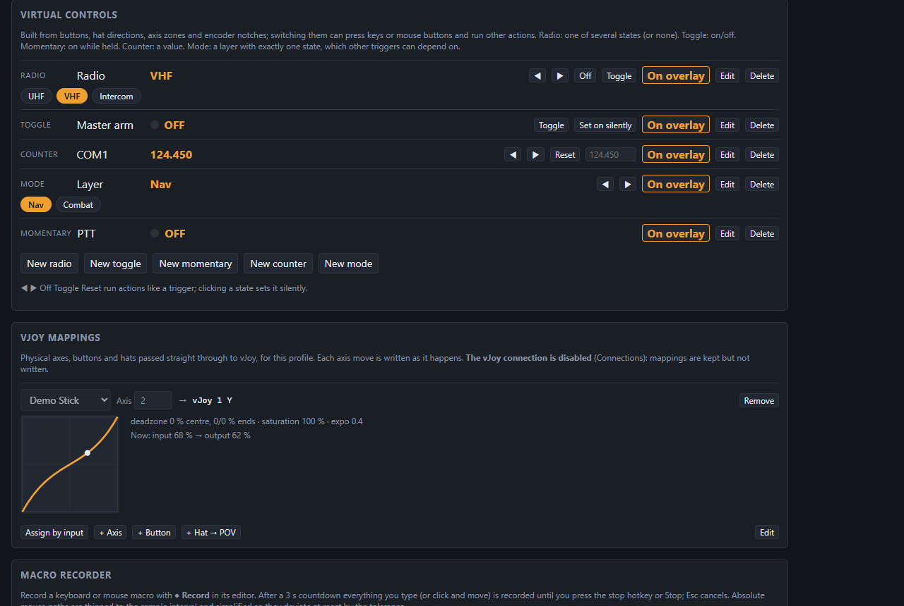
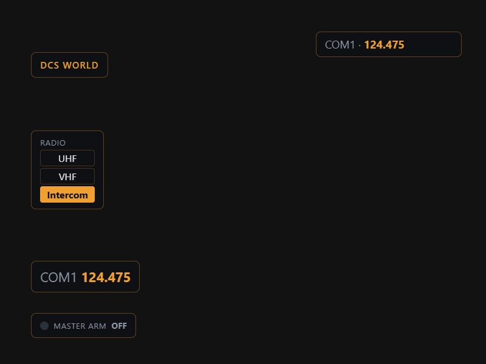
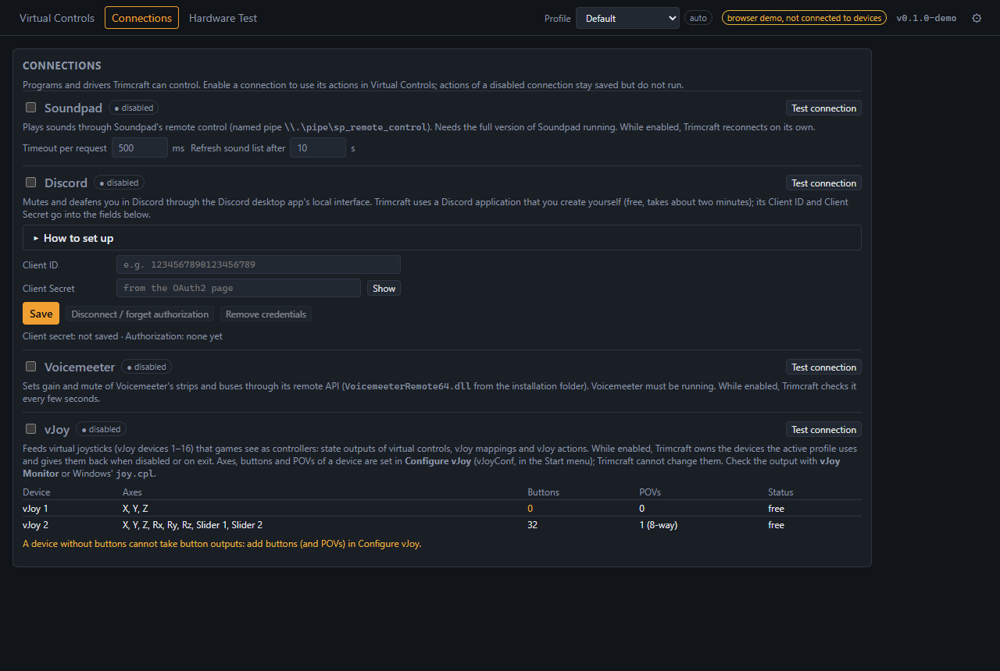
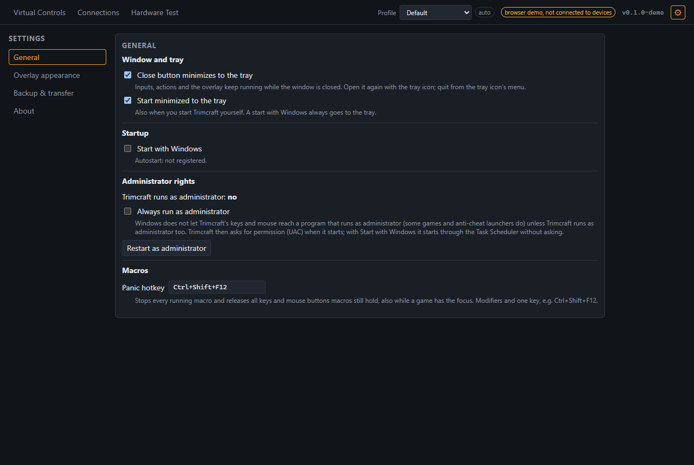

# Trimcraft

> [!WARNING]
> **⚠️ Unstable early access, under active development.** Expect bugs and breaking changes
> between versions. Keep backups of your configuration: Trimcraft writes them automatically
> (Settings → Backup & transfer), and you can export it at any time.

> [!TIP]
> **Found a bug or have an idea? Please open a [GitHub Issue](https://github.com/trimcraft/trimcraft/issues/new/choose).**
> There are templates for [bug reports](https://github.com/trimcraft/trimcraft/issues/new?template=bug_report.yml)
> and [feature requests](https://github.com/trimcraft/trimcraft/issues/new?template=feature_request.yml).
> Ideas and wishes from real cockpits are explicitly welcome.

Turn your HOTAS into a smart cockpit on Windows: virtual radios, modes and switches, macros,
vJoy output, Discord/Soundpad control and a click-through in-game overlay.

Trimcraft was formerly called Detent; see [Upgrading from Detent](#upgrading-from-detent).

## Features

- **Devices:** every connected stick, throttle, pedal set and button box, live, with a stable
  identity across restarts and re-plugging (also for two units of the same model).
- **Rotary encoders** recognised by their behaviour, with measured pulse lengths.
- **Virtual controls:** radios, toggles, momentary controls, counters and modes (layers),
  triggered by buttons, hat directions, encoder notches or axis zones, with long and double
  presses, modifiers and conditions.
- **Actions:** keyboard and mouse macros (with a recorder, repetition and a panic hotkey),
  speech, sound files, volume and media keys, launching programs, HTTP requests (webhooks),
  Soundpad, Discord mute/deafen, Voicemeeter and vJoy.
- **vJoy output:** control states, axis mappings with curves and deadzones, and vJoy actions
  feed virtual joysticks that games see as ordinary controllers.
- **Profiles** per game, switched automatically by the program in the foreground.
- **Overlay:** a transparent, click-through, always-on-top window with your controls and
  toasts on changes, freely placed per monitor and themeable.
- **Backups, export and import** of the whole configuration or single profiles.
- **Event log** of everything Trimcraft sees and does.

The [user guide](docs/user-guide.md) explains every part in detail.

## Screenshots

| Virtual controls | Overlay |
|---|---|
|  |  |
| **Connections** | **Settings** |
|  |  |

The screenshots show the browser demo with made-up devices. More: [Hardware Test](docs/images/hardware-test.png),
[Credits](docs/images/credits.png).

## Requirements

- Windows 10 or 11 (64-bit). Other systems are not supported.
- The overlay works over games in **windowed or borderless fullscreen** mode, not in exclusive
  fullscreen.
- Optional, for the matching features: [vJoy](https://github.com/BrunnerInnovation/vJoy),
  Soundpad (full version), the Discord desktop app, Voicemeeter.

## Installation

1. Download `Trimcraft_<version>_x64-setup.exe` from the
   [latest release](https://github.com/trimcraft/trimcraft/releases/latest).
2. Run it. It installs for the current user; no administrator rights needed.
3. The installer and the program are **not code-signed**, so Windows SmartScreen warns on the
   first start ("Windows protected your PC"): click **More info**, then **Run anyway**.

Trimcraft looks for updates and installs them from **Settings → Updates**.

## Upgrading from Detent

Trimcraft was called Detent before. Quit Detent, install Trimcraft and start it; on its first
start it takes over the Detent installation and logs each step (app log and event log, lines
starting with `migration:`):

- **Settings, devices, values, backups:** `%APPDATA%\cloud.breu.detent` is copied to
  `%APPDATA%\cloud.breu.trimcraft`, unless Trimcraft has a `setup.json` of its own already.
  Old logs are copied from `%LOCALAPPDATA%\cloud.breu.detent\logs`; the WebView data is not.
  The old folders stay, with a `MIGRATED_TO_TRIMCRAFT.txt` note; delete them once everything works.
- **Credentials:** Credential Manager entries `detent/...` (Discord client secret and login,
  HTTP header secrets) are moved to `trimcraft/...`; an old entry is deleted only after the new
  one was written and read back. The references in the setup, in backups and in imported files
  are renamed when they load.
- **Autostart:** Detent's `Run` value is removed and Trimcraft registers its own from the
  settings. Detent's elevated task can only be removed as administrator; with "Always run as
  administrator" on, Trimcraft restarts elevated and removes it then.
- **Exports:** `.detent.json` files import like `.trimcraft.json` files.

Detent and Trimcraft do not see each other as the same app: a Detent that still runs neither
blocks Trimcraft nor gets its second launches, and both would react to the same inputs, so
Trimcraft warns when it finds one running. Uninstall Detent afterwards (its uninstaller leaves
Trimcraft's files and autostart alone).

## Running as administrator

Windows does not let a normal program send keys and mouse input to a program that runs as
administrator. If a game (or its launcher) runs as administrator, Trimcraft must too, or its
macros will not reach the game. Trimcraft warns when that happens. **Settings → General →
Always run as administrator** makes it restart elevated (UAC prompt); with *Start with Windows*
it then starts through the Task Scheduler without a prompt.

## Anti-cheat and fair play

- Trimcraft **never injects into game processes**: no DLLs, no graphics hooks, no reading or
  writing game memory. The overlay is a separate transparent window on top of the game.
- Macros send simulated keyboard and mouse input (`SendInput`), and vJoy creates virtual
  controllers. Some games and multiplayer servers forbid automated input or macros. **Using
  them is your own responsibility**: check the rules of the game and server you play on.

## Privacy

- No telemetry, no accounts, no analytics. Trimcraft only goes online for what you configure
  (Discord sign-in, your HTTP requests) and for update checks.
- Everything stays on your computer: settings in `%APPDATA%\cloud.breu.trimcraft`, logs in
  `%LOCALAPPDATA%\cloud.breu.trimcraft\logs`.
- Secrets (Discord client secret and tokens, secret HTTP headers) are stored in the **Windows
  Credential Manager**, never in the settings files, exports or logs.

## Connections

Set up under **Connections**; each one can be tested there. Details in the
[user guide](docs/user-guide.md#connections).

- **Soundpad:** needs the **full version** of Soundpad, running (Trimcraft uses its remote
  control).
- **Discord:** uses your own free Discord application; the Discord card has a step-by-step
  guide with a link to the Developer Portal. Needs the Discord desktop app.
- **Voicemeeter:** Standard, Banana or Potato, installed and running.
- **vJoy:** install [vJoy](https://github.com/BrunnerInnovation/vJoy) and add buttons and POVs
  to its devices in *Configure vJoy*; Trimcraft shows what each device has.

## Build from source

Requirements: Rust (stable, MSVC toolchain), Node 24, CMake (SDL3 is built from source and
linked statically), Windows 10/11.

```sh
npm ci
npx tauri dev                       # app with real devices
TRIMCRAFT_INPUT=mock npx tauri dev  # app with synthetic devices (no hardware needed)
npm run dev                         # UI only, in a browser, with an in-page demo
./scripts/check.sh                  # full gate, same as CI; run before every push
```

The SDL3 build fails on Windows' 260-character path limit in deep folders: set
`CARGO_TARGET_DIR` to a short path (e.g. `C:\t\trimcraft`) if the checkout is nested deeply.

| Path | What |
|---|---|
| `crates/trimcraft-core` | Platform-independent logic, unit-tested: devices, encoders, virtual controls, triggers, actions, profiles, overlay, migrations. |
| `crates/trimcraft-input` | Input backends: SDL3 and a mock with synthetic devices. |
| `src-tauri` | Desktop app (Tauri 2): engine thread, windows, connectors, persistence. |
| `ui` | Svelte 5 + TypeScript: main window and overlay. |

[CLAUDE.md](CLAUDE.md) is the working guide for the code base (for people and coding agents).

## Contributing

Bug reports, ideas and pull requests are welcome; see [CONTRIBUTING.md](CONTRIBUTING.md).
Security problems: [SECURITY.md](SECURITY.md). This project follows the
[Contributor Covenant](CODE_OF_CONDUCT.md).

## Credits

Maintained by Samuel Breu ([@bresam](https://github.com/bresam)). Contributors, supporters and
the open source projects Trimcraft is built on are listed in [CREDITS.md](CREDITS.md), also in
the app under Settings → About → Credits.

## Support Trimcraft

Trimcraft is free and stays free, without ads, nags or locked features. The most valuable
support is feedback: [open an issue](https://github.com/trimcraft/trimcraft/issues/new/choose)
with bugs, ideas or wishes from your cockpit.

<!-- TODO(orchestrator): donation links are not live yet. Once the accounts exist, set
     SUPPORT_URLS in src-tauri/src/commands.rs, uncomment .github/FUNDING.yml and the badges
     below (replace <name>), and drop this comment.
[](https://github.com/sponsors/<name>)
[](https://ko-fi.com/<name>)
-->

## Licence

Trimcraft is free software under the [GNU General Public License v3.0 or later](LICENSE).
The licences of the third-party software it contains are in
[THIRD_PARTY_LICENSES](THIRD_PARTY_LICENSES) (also under Settings → About).

## Trademarks

Trimcraft is an independent project and is not affiliated with, endorsed or sponsored by
Discord, Leppsoft (Soundpad), VB-Audio (Voicemeeter), the vJoy project, Turtle Beach, VKB,
Thrustmaster, Logitech, Virpil, WinWing, Microsoft or any game publisher. All product names,
logos and trademarks belong to their owners and are used only to describe compatibility.
